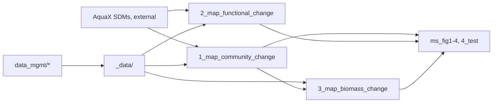

# chi_shifts

Examining how cumulative human impacts change as stressors and species ranges shift over time. The current analysis uses AquaX species distribution models (SDMs) under current and projected (RCP4.5/8.5, 2050) conditions to map change in species and functional entity (FE) richness and turnover, compares these against projected consumer biomass change (ISIMIP), and contrasts coastal and open-ocean regions.

## Pipeline

Run the `data_mgmt/` scripts first if a needed dataset is missing from `_data/`, then the numbered analysis scripts in order, then the manuscript figure scripts.

### `data_mgmt/` (build inputs in `_data/`)

| Script | Produces |
|---|---|
| `data_access_vuln_traits.qmd` | `_data/ohara_2024/spp_vuln_framework_{traits,scores}/` (KNB download) |
| `data_access_funct_entities.qmd` | `_data/ohara_2024/funct_entity_traits/` |
| `data_access_isimip.qmd` | `_data/isimip_2026/` (ISIMIP3b biomass projections) |
| `data_access_bathymetry.qmd` | `_data/gebco_2026/` (GEBCO bathymetry at 0.05°) |
| `data_access_eez_meow.qmd` | `_data/mregions_2026/` (MEOW ecoregion raster and lookups) |

`_data/mregions_2026/meow_lookup_complete.csv` and `world_continents.gpkg` are manual downloads (see the script).

### `scripts/` (analysis and figures)

| Script | Purpose | Main outputs |
|---|---|---|
| `1_map_community_change.qmd` | Species richness, turnover, extirpation/colonization by pixel and scenario | `_output/spp_turnover_maps/` |
| `2_map_functional_change.qmd` | Same for functional entities | `_output/fe_turnover_maps/` |
| `3_map_biomass_change.qmd` | ISIMIP biomass model ensemble, mean relative change on the Behrmann 5 km grid; uses the species richness raster from script 1 as its ocean mask | `_output/biomass_change_maps/` |
| `4_test_turnover_coastal_oceanic.qmd` | Coastal vs. oceanic turnover comparison (GEBCO bathymetry) | (HTML report) |
| `ms_fig1_richness_and_change.qmd` | Fig. 1, S1, S2, S5 | `ms_figs/` |
| `ms_fig2_turnover.qmd` | Fig. 2, S3 | `ms_figs/` |
| `ms_fig3_barplot_compare_by_region.qmd` | Fig. 3, S4 (turnover by MEOW realm/province, coastal vs. ocean) | `ms_figs/` |
| `ms_fig4_turnover_vs_biomass.qmd` | Fig. 4 (turnover vs. biomass change) | `ms_figs/`, `_output/figure_data/` |

`scripts/common_fxns.R` holds shared helpers and is sourced at the top of each script.

## Folder layout

| Folder | Contents |
|---|---|
| `data_mgmt/` | Scripts that download/build raw inputs |
| `scripts/` | Analysis and figure scripts, `common_fxns.R` |
| `_data/` | Input data, one subfolder per source (each with a README) |
| `_output/` | Generated intermediate outputs (each subfolder has a README naming its script) |
| `ms_figs/` | Manuscript and supplemental figures (PNG) |
| `tmp/` | Scratch space for chunked processing (safe to delete when no run is in progress) |

AquaX SDM source data live outside the repo at `/home/shares/data-aquax/` (read-only shared server).

## Notes

- Several figure scripts (`ms_fig1`, `ms_fig2`, `ms_fig4` data) skip regeneration if the output already exists. Delete the file to refresh after upstream reruns.
- Scripts 1 and 2 are long-running and use DuckDB on a shared server; see `get_sdm()` for thread and memory caps.
